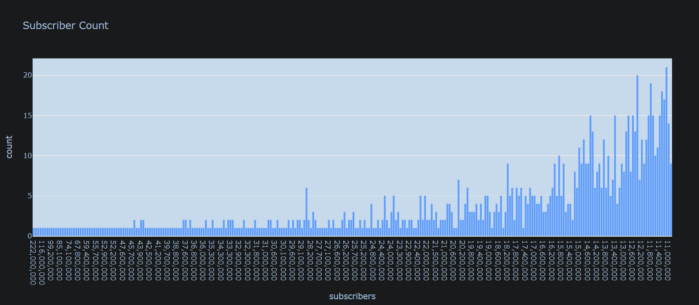
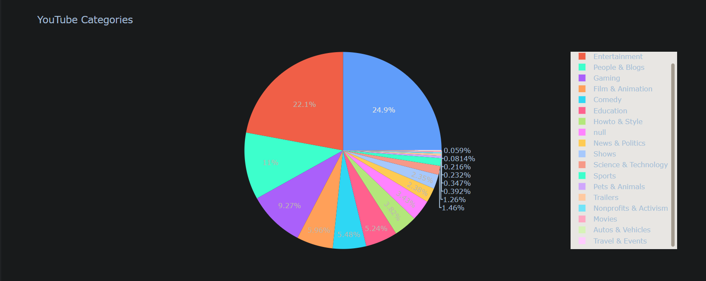
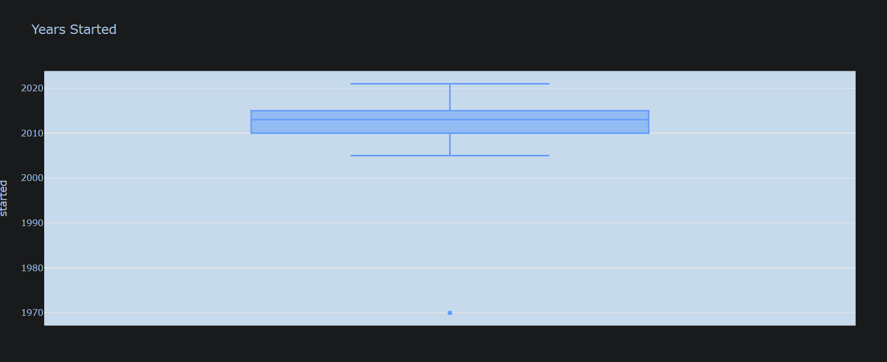

# YouTube Data Visualization

An exploratory data analysis and visualization project that studies the most subscribed YouTube channels using Python, Pandas, and Plotly Express.

## Overview

This project explores a dataset of popular YouTube channels to understand subscriber distributions, channel categories, and the years in which channels were established. Interactive visualizations make the data easier to interpret and compare.

## Objectives

- Explore and understand the YouTube channels dataset.
- Load and process CSV data using Pandas.
- Visualize subscriber count distributions.
- Compare subscriber totals across channel categories.
- Explore channel creation years using a box plot.
- Practice exploratory data analysis and data visualization.

## Technologies Used

- Python
- Pandas
- Plotly Express
- Google Colab
- Jupyter Notebook

## Visualizations

### 1. Subscriber Count Distribution
A histogram to examine how subscriber counts are distributed across channels.

### 2. YouTube Channel Categories
A pie chart to compare subscriber totals across different channel categories.

### 3. Channel Creation Years
A box plot to examine the distribution of years in which channels started.
## Project Screenshots

### Subscriber Count Distribution

### YouTube Channel Categories

### Channel Creation Years

## Key Findings

### 1. Subscriber Count Distribution
The histogram shows that the distribution of subscriber counts is uneven, with many channels concentrated in the lower subscriber ranges and relatively few channels reaching exceptionally high subscriber counts. This suggests that a small number of highly popular channels stand out from the rest of the dataset. The distribution is concentrated toward lower subscriber values, with a long tail extending toward higher counts.

### 2. YouTube Channel Categories
The pie chart compares the share of total subscribers across different YouTube channel categories. Music accounts for the largest share at approximately **24.9%**, followed by Entertainment at **22.1%**. People & Blogs represents approximately **11%**, while Gaming accounts for **9.27%**.

Film & Animation contributes approximately **5.96%**, Comedy approximately **5.48%**, and Education approximately **5.24%**. The remaining categories account for smaller individual shares.

These observations suggest that Music and Entertainment have a particularly strong presence among the channels represented in this dataset. Some categories also have very small shares, indicating that subscriber totals are distributed unevenly across categories.

### 3. Channel Creation Years
The box plot summarizes the distribution of the years in which the channels started. Most of the central distribution lies approximately between **2010 and 2015**, with the median appearing around **2013**. The lower whisker extends to approximately 2005, while the upper whisker reaches approximately 2021.

A point around **1970** appears as a potential outlier, considerably earlier than the other channel start years. This value should be checked against the original dataset to determine whether it represents a genuine observation or a data-quality issue.

### Overall Conclusion
The visualizations reveal three main patterns: subscriber counts are unevenly distributed across channels, Music and Entertainment account for substantial shares of subscribers, and most channel start years in the dataset are concentrated in the 2010s. Together, these findings demonstrate how exploratory data visualization can help identify distributions, compare categories, and detect unusual observations in a dataset.

## Dataset

The project uses the Most Subscribed YouTube Channels dataset.

Dataset source: [Kaggle](https://www.kaggle.com/)

Check the original dataset's license and terms before redistributing its contents.

## How to Run

1. Download or clone this repository.
2. Open `youtube_data_visualization.ipynb` in Google Colab or Jupyter Notebook.
3. Install the required dependencies if necessary.
4. Obtain the dataset from its original source.
5. Upload the CSV when prompted by the notebook.
6. Run the notebook cells in order to reproduce the analysis and visualizations.

## Learning Outcomes

- Reading CSV files into Pandas DataFrames.
- Inspecting and processing tabular data.
- Creating interactive charts with Plotly Express.
- Understanding basic exploratory data analysis.
- Communicating patterns in data visually.

## Future Improvements

- Add more visualizations comparing views, subscribers, and video counts.
- Investigate relationships between subscribers and total video views.
- Add data cleaning and missing-value checks.
- Build a simple interactive dashboard using Streamlit.

## Author

Created as part of my data science and Python learning journey.
